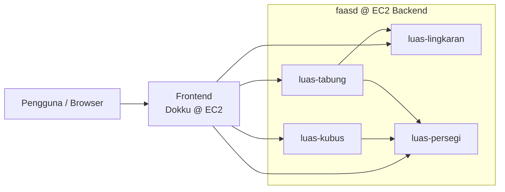

# Lab 08 Komputasi Awan: Kalkulator Geometri

Kalkulator geometri berbasis **microservices**. Empat service dijalankan dengan **faasd** di AWS EC2, dan satu frontend web di-hosting dengan **Dokku** di AWS EC2.

| Komponen | Teknologi | Fungsi |
|---|---|---|
| Backend | Python + faasd | 4 microservices perhitungan |
| Infrastruktur | AWS EC2 | Server backend dan frontend |
| Frontend | HTML, CSS, JavaScript | Tampilan kalkulator (4 menu) |
| Deployment frontend | Dokku | Hosting aplikasi frontend |

## Arsitektur



Service `luas-kubus` memanggil `luas-persegi`, sedangkan `luas-tabung` memanggil `luas-persegi` dan `luas-lingkaran`.

## Tim

| Anggota | NPM | Tugas |
|---|---|---|
| Joanne Kenisa Adelina Limena | 2306275626 | Backend: `luas-persegi` dan `luas-lingkaran`, instalasi faasd di EC2 |
| Muhammad Almerazka Yocendra | 2306241745 | Backend: `luas-kubus` dan `luas-tabung`, AWS yang digunakan |
| Agus Tini Sridewi | 2306276004 | Frontend: 4 menu kalkulator, deployment Dokku |

## Struktur repository

```
lab08-kowan/
├── backend/
│   ├── stack.yml            # definisi 4 function untuk faas-cli
│   ├── luas-persegi/        # handler.py, requirements.txt
│   ├── luas-kubus/
│   ├── luas-lingkaran/
│   └── luas-tabung/
└── frontend/                # index.html, style.css, script.js, Procfile
```

> Dockerfile tiap function disediakan oleh template faasd (`python3-http`) yang di-pull oleh `faas-cli`, sehingga tidak ada di folder masing-masing. Jika praktikum memakai template lain, sesuaikan `lang` di `backend/stack.yml`.

## Kontrak API

Format request dan response berikut sudah disepakati bersama

| Service | Request | Response | Rumus |
|---|---|---|---|
| `luas-persegi` | `{"sisi": 5}` | `{"luas": 25}` | L = s × s |
| `luas-kubus` | `{"sisi": 5}` | `{"luas_permukaan": 150}` | L = 6 × L<sub>persegi</sub> |
| `luas-lingkaran` | `{"jari_jari": 7}` | `{"luas": 153.94}` | L = π r² |
| `luas-tabung` | `{"jari_jari": 7, "tinggi": 10}` | `{"luas_selimut": 439.82}` | L = 2 π r t |

### Endpoint

Ganti `<IP-FAASD>` dengan IP publik EC2 backend.

```
POST http://<IP-FAASD>:8080/function/luas-persegi
POST http://<IP-FAASD>:8080/function/luas-kubus
POST http://<IP-FAASD>:8080/function/luas-lingkaran
POST http://<IP-FAASD>:8080/function/luas-tabung
```

Antar-service saling memanggil lewat gateway internal: `http://gateway.openfaas:8080/function/<nama-service>`.

### Contoh pemanggilan

```bash
curl -X POST http://<IP-FAASD>:8080/function/luas-kubus \
  -H "Content-Type: application/json" \
  -d '{"sisi": 5}'
# {"luas_permukaan": 150}

curl -X POST http://<IP-FAASD>:8080/function/luas-tabung \
  -H "Content-Type: application/json" \
  -d '{"jari_jari": 7, "tinggi": 10}'
# {"luas_selimut": 439.82}
```

## Alur kerja Git kami

1. Clone repo: `git clone https://github.com/kendelline/lab08-kowan.git`
2. Kerjakan di folder milik masing-masing agar tidak terjadi konflik.
3. Sebelum mulai: `git pull`. Setelah selesai: `git add .`, `git commit -m "pesan"`, `git push`.
4. Di EC2: `git pull`, lalu deploy sesuai bagian di bawah.

## Deployment

### Backend (EC2 faasd)

```bash
cd backend
faas-cli template store pull python3-http
faas-cli login --gateway http://<IP-FAASD>:8080
faas-cli up -f stack.yml
faas-cli list
```

Sebelum deploy, isi `<IP-FAASD>` dan `<REGISTRY-USER>` di `backend/stack.yml`.

### Frontend (EC2 Dokku)

Folder `frontend/` berisi situs statis (`index.html`, `style.css`, `script.js`) beserta `Procfile`. Deploy ke app Dokku mengikuti materi praktikum. Pastikan endpoint di `script.js` sudah mengarah ke IP backend yang benar.

## Catatan keamanan

- Jangan commit file `.pem`, password gateway faasd, atau file `.env` (sudah diabaikan lewat `.gitignore`).
- Jangan membuka gateway faasd ke publik tanpa pembatasan akses di Security Group.
- Jika frontend diakses publik, atur CORS dan, bila memungkinkan, gunakan reverse proxy.
